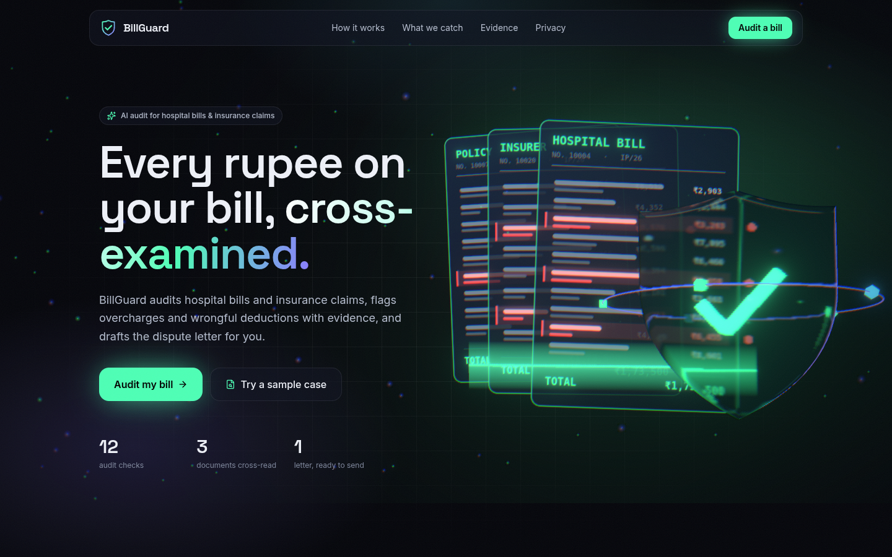
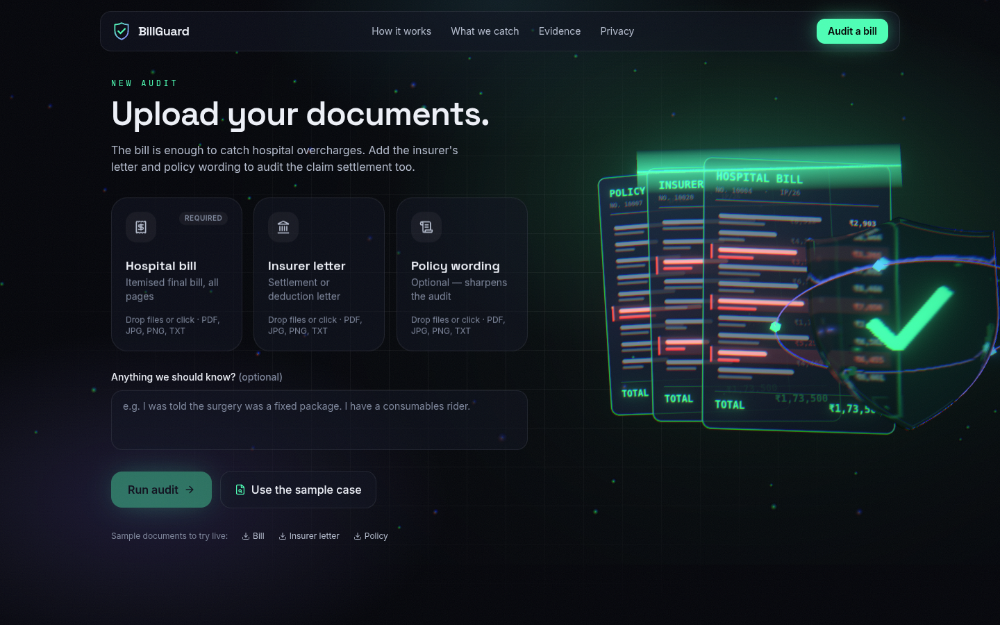
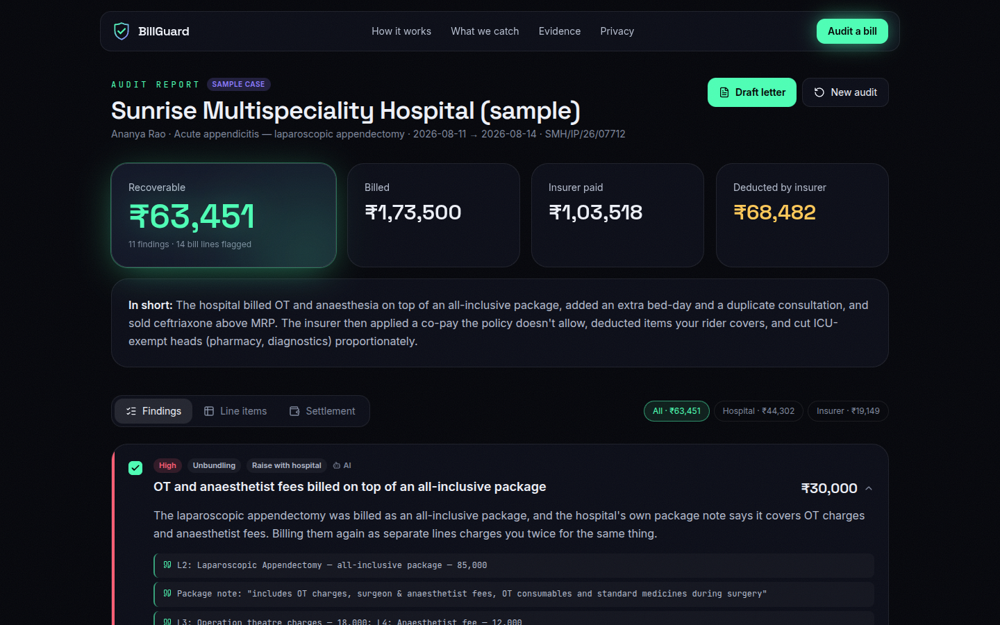
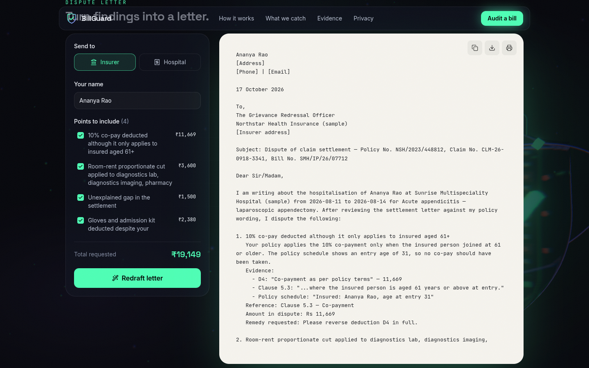
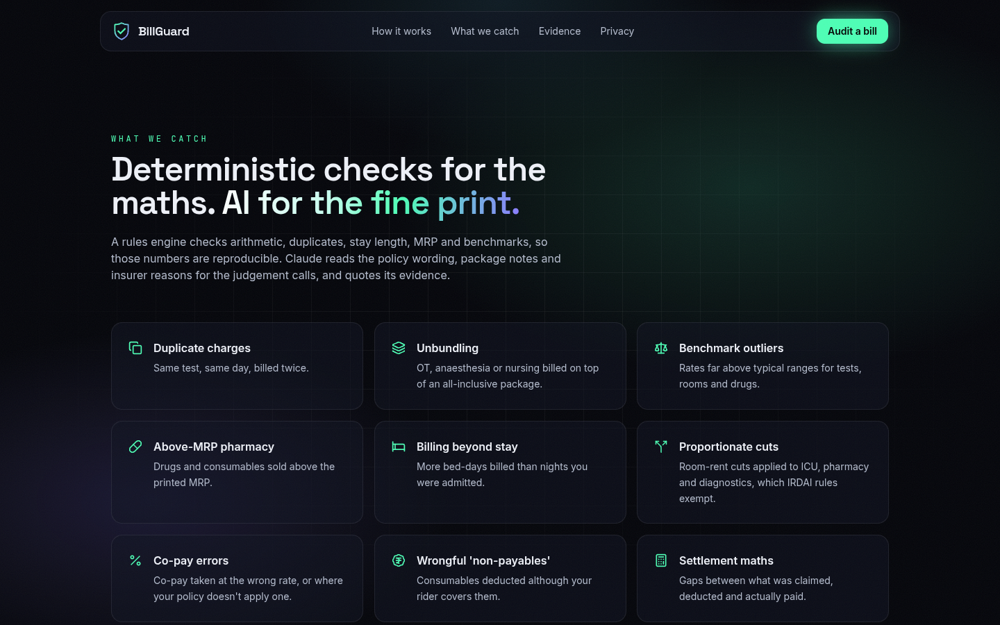
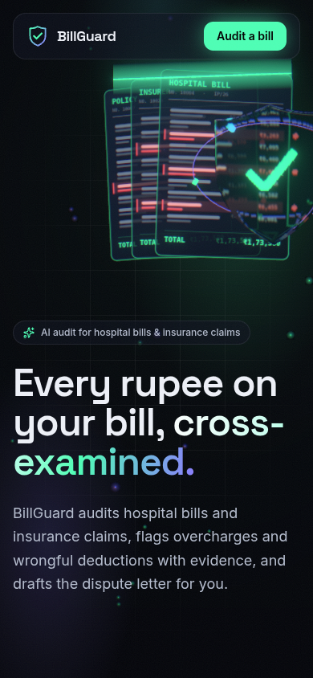
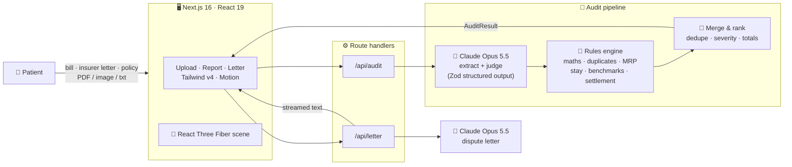

<div align="center">

# 🛡️ BillGuard

### *Every rupee on your bill, cross-examined.*

**An AI tool that audits hospital bills and insurance claims, flags overcharges and wrongful deductions with evidence, and drafts the dispute letter for you.**

<br/>


<br/>

[📖 About](#-about) •
[✨ Features](#-features) •
[📸 Screenshots](#-screenshots) •
[🏗️ Architecture](#️-architecture) •
[🚀 Getting Started](#-getting-started) •
[📡 API](#-api-reference) •
[🎨 Design](#-design-system)

<br/>



</div>

---

## 📖 About

Hospital bills in India are long, coded and easy to pad. Insurance settlement letters are worse: deductions cite "policy terms" without saying which ones. Most patients pay the difference because checking every line against the policy wording takes hours they don't have.

**BillGuard** does that checking for you:

- 🧾 **Upload** the itemised hospital bill and the insurer's settlement letter, plus the policy wording if you have it. PDFs, phone photos and text files all work.
- 🔎 **Cross-examine:** every line item is extracted, then checked for duplicates, bundling errors, MRP violations and price outliers. Every deduction is tested against your policy wording and IRDAI rules.
- ✉️ **Dispute:** you get a ranked list of exactly what to contest, why, and how much, with evidence quoted from your own documents. A dispute letter for the hospital or the insurer is drafted and ready to send.

It's built for **Indian health insurance** (INR, IRDAI regulations, CGHS/NPPA-style benchmarks), but the pipeline is currency-agnostic.

---

## ✨ Features

### 🔍 What it catches

| Check | Engine | What it means |
|---|---|---|
| 📋 **Duplicate charges** | Rules | Same item, same day, same amount billed more than once |
| 📦 **Unbundling** | AI | OT, anaesthesia or nursing billed on top of an all-inclusive package or room tariff |
| 📊 **Benchmark outliers** | Rules | Tests, rooms and drugs priced far above typical ranges |
| 💊 **Above-MRP pharmacy** | Rules | Drugs or consumables sold above the printed MRP |
| 🛏️ **Billing beyond stay** | Rules | More bed-days billed than nights you were admitted |
| 🧮 **Arithmetic errors** | Rules | Qty × rate ≠ amount, or a grand total higher than the sum of lines |
| ✂️ **Proportionate cuts** | Rules + AI | Room-rent cuts applied to ICU, pharmacy, consumables or diagnostics, which IRDAI exempts |
| ％ **Co-pay errors** | AI | Co-pay taken at the wrong rate, or where the policy doesn't apply one |
| 🚫 **Wrong "non-payables"** | AI | Consumables deducted even though your rider covers them |
| 💸 **Settlement gaps** | Rules | Claimed − deductions ≠ approved, so money is missing without explanation |
| 📜 **Policy violations** | AI | Deductions that contradict the policy wording or cite no clause |

### 🧾 The audit report

| Feature | Description |
|---|---|
| 💰 **Recoverable total** | Headline amount you can dispute, next to billed / paid / deducted |
| 🗂️ **Evidence cards** | Each finding quotes the bill line, insurer reason or policy clause behind it, with a severity, the amount at stake and the exact remedy to ask for |
| 🏷️ **Who to raise it with** | Every finding is tagged *hospital* or *insurer*, with totals per party |
| 🤖 **AI vs Rule badges** | You can see whether a finding came from Claude's reading or the deterministic rules engine |
| 📑 **Line-item table** | Every extracted line, with flagged rows highlighted and linked to their findings |
| 🌊 **Settlement waterfall** | Claimed → each deduction → approved, with disputed deductions marked |

### ✉️ Dispute letters

| Feature | Description |
|---|---|
| 🎯 **Pick recipient & points** | Insurer (Grievance Redressal Officer) or hospital (Billing / Patient Relations); choose which findings to include |
| ⚡ **Streams live** | The letter writes itself onto a paper panel in real time |
| ✏️ **Editable** | Tweak the text, then copy, download as `.txt` or print |
| 🏛️ **Escalation built in** | Insurer letters mention the Insurance Ombudsman and the IRDAI Bima Bharosa portal |

### 🌐 Experience

| Feature | Description |
|---|---|
| 🧊 **Full 3D scene** | Holographic bill sheets, a laser scan that pops red pins on flagged rows, and a glass shield with a glowing check, all in React Three Fiber with bloom |
| 🎛️ **Reactive** | The scene follows the mouse, reacts to scroll, speeds up while auditing and settles when the report is ready |
| 🃏 **3D tilt cards** | Glass cards tilt toward the pointer with a moving highlight |
| 🧪 **Demo mode** | Runs without an API key on a built-in sample case, so anyone can try it |
| 📱 **Responsive** | From 390px phones to wide desktops; respects `prefers-reduced-motion` |

---

## 📸 Screenshots

<table>
  <tr>
    <td width="50%"><p align="center"><b>Upload</b>: bill, insurer letter and policy</p></td>
    <td width="50%"><p align="center"><b>Audit report</b>: recoverable total and evidence</p></td>
  </tr>
  <tr>
    <td width="50%"><p align="center"><b>Dispute letter</b>: drafted and editable</p></td>
    <td width="50%"><p align="center"><b>What we catch</b></p></td>
  </tr>
</table>

<div align="center">

<p><b>Mobile</b></p>
</div>

---

## 🏗️ Architecture



### How an audit works

1. **Extract + judge (one Claude call).** The documents go to Claude Opus 5.5 with a [Zod](https://zod.dev) schema as structured output. It returns every line item exactly as printed, every deduction with the insurer's wording, the policy limits and clauses that matter, and the findings that need judgement (bundling, clause mismatches, co-pay, riders), each with verbatim evidence.
2. **Rules engine.** [`src/lib/rules.ts`](src/lib/rules.ts) re-checks the extracted data deterministically: arithmetic, exact duplicates, bed-days vs stay length, MRP, benchmark outliers, bill totals, settlement maths, and proportionate cuts on exempt heads. These numbers are reproducible.
3. **Merge & rank.** Rule findings that duplicate an AI finding are dropped; the rest are sorted by severity and amount, and the totals are computed.
4. **Letter.** A second Claude call streams a formal dispute letter that uses only the selected findings' facts.

> 🛟 Both Claude calls have server-side refusal fallback enabled (`fallbacks: "default"`).

---

## 🛠️ Tech Stack

| Layer | Technology |
|---|---|
| **Framework** | Next.js 16 (App Router, route handlers), React 19, TypeScript |
| **Styling** | Tailwind CSS v4, glassmorphism utilities, Space Grotesk · Inter · JetBrains Mono |
| **3D** | Three.js, React Three Fiber, drei (`MeshTransmissionMaterial`, `Float`, `Sparkles`, `Lightformer`), postprocessing (Bloom, Chromatic Aberration, Vignette) |
| **Animation** | Motion (scroll reveals, counters, transitions) |
| **AI** | Anthropic SDK · Claude Opus 5.5 · adaptive thinking · structured outputs · streaming |
| **Validation** | Zod v4 |
| **Icons** | Lucide |

---

## 🚀 Getting Started

### Prerequisites

- **Node.js 20+**
- An **Anthropic API key** (optional: without one the app runs in demo mode)

### Install & run

```bash
git clone https://github.com/likith1231/billguard.git
cd billguard
npm install
cp .env.example .env.local     # add your ANTHROPIC_API_KEY
npm run dev
```

Open **http://localhost:3000**, or jump straight to the sample case at **http://localhost:3000/audit?sample=1**.

### 🧪 Try it with the sample documents

[`public/samples/`](public/samples) has a fictitious, internally consistent case: a hospital bill, insurer letter and policy extract. With an API key set, upload them on `/audit` to watch the live pipeline find the same issues as the built-in demo (about **₹63,451** recoverable across 11 findings).

### Scripts

| Command | Description |
|---|---|
| `npm run dev` | Start the dev server |
| `npm run build` | Production build |
| `npm start` | Serve the production build |
| `npm run lint` | ESLint |

---

## 🔐 Environment Variables

| Variable | Required | Description |
|---|---|---|
| `ANTHROPIC_API_KEY` | No | Enables live audits and AI-written letters. **Without it, BillGuard runs in demo mode**: `/api/audit` returns the sample case and letters use a deterministic template. |

> 🔒 `.env.local` is git-ignored. Never commit your key.

---

## 📡 API Reference

### `POST /api/audit`

`multipart/form-data`

| Field | Type | Description |
|---|---|---|
| `bill` | file(s) | **Required.** Hospital bill: PDF, PNG, JPG, WebP or TXT |
| `insurer_letter` | file(s) | Settlement / deduction letter |
| `policy` | file(s) | Policy wording |
| `notes` | string | Optional context from the patient (max 2,000 chars) |
| `demo` | `"1"` | Force the sample case |

Returns an `AuditResult`: the extraction, ranked `findings[]` (each with `type`, `severity`, `evidence[]`, `disputedAmount`, `lineIds`, `deductionIds`, `action`, `source: "ai" \| "rules"`), `totals` and `mode: "live" \| "demo"`. Limit: 20 MB total.

### `POST /api/letter`

`application/json`: `{ audit, recipient: "insurer" | "hospital", findingIds: string[], sender? }`

Streams the letter as `text/plain`.

---

## 📁 Project Structure

```
billguard/
├── public/samples/              # Sample bill, insurer letter & policy (fictitious)
├── docs/screenshots/            # README images
└── src/
    ├── app/
    │   ├── page.tsx             # 3D landing page
    │   ├── audit/page.tsx       # Audit app
    │   └── api/
    │       ├── audit/route.ts   # Upload → Claude → rules → AuditResult
    │       └── letter/route.ts  # Streams the dispute letter
    ├── components/
    │   ├── three/Scene.tsx      # R3F scene: bill sheets, scan beam, glass shield
    │   ├── audit/               # Uploader, Scanning, Results, FindingCard,
    │   │                        # LineTable, Settlement (waterfall), LetterPanel
    │   └── ui/                  # Background3D, TiltCard, Nav, Counter, Reveal, Logo
    └── lib/
        ├── schema.ts            # Zod schemas: line items, deductions, findings
        ├── claude.ts            # Anthropic client, audit + letter prompts
        ├── rules.ts             # Deterministic checks, merge & ranking
        ├── benchmarks.ts        # Indicative price bands
        ├── sample.ts            # Demo-mode sample case
        ├── letter-template.ts   # Demo-mode letter
        └── format.ts            # Money & label helpers
```

---

## 🎨 Design System

| Swatch | Token | Hex | Usage |
|---|---|---|---|
|  | `bg` | `#04050A` | Page background |
|  | `mint` | `#4DFFB5` | Brand: buttons, glow, recoverable amounts |
|  | `violet` | `#8B7BFF` | Secondary glow, gradients |
|  | `cyan` | `#5AD7FF` | Low severity, accents |
|  | `coral` | `#FF5D73` | High severity, flagged lines, disputed deductions |
|  | `amber` | `#FFC857` | Medium severity, deductions |
|  | `ink` | `#EEF1F8` | Text |

- 🔤 **Typography:** Space Grotesk (display), Inter (body), JetBrains Mono (evidence & codes)
- 🪟 **Glassmorphism:** `.glass` and `.glass-strong` utilities
- 🧊 **3D background:** one fixed R3F canvas with modes `hero` → `calm` → `scan` → `done`; it fades back behind content as you scroll
- ♿ **Accessible:** severity is shown by label and icon as well as colour; motion is reduced when the OS asks for it

---

## ☁️ Deployment

| Part | Platform | Notes |
|---|---|---|
| 🖥️ App + API | **Vercel** (or any Node host) | Set `ANTHROPIC_API_KEY` in the project's environment variables. `/api/audit` sets `maxDuration = 300`, so long bills need a plan that allows 5-minute functions. |

---

## ⚠️ Disclaimer

- BillGuard gives an **informational audit, not legal or medical advice**. Check each finding before you send a dispute.
- Benchmarks in [`src/lib/benchmarks.ts`](src/lib/benchmarks.ts) are **indicative ranges, not official tariffs**. Swap in your city's CGHS rates, your insurer's PPN rates or NPPA ceiling prices.
- Regulatory references are to IRDAI's 2024 Master Circular on Health Insurance; **your policy wording governs**.
- Uploaded files are processed in memory and sent only to the Anthropic API. BillGuard stores nothing.
- The sample hospital, insurer and patient are fictitious.

---

## 🗺️ Roadmap

- [ ] 🔌 Free rules-only mode that parses text-based PDFs without an API key
- [ ] 🏥 Official CGHS / PPN / NPPA rate tables by city
- [ ] 📄 Export the audit report as PDF
- [ ] 📧 Send the letter by email directly from the app
- [ ] 🗃️ Save audits to an account and track dispute status
- [ ] 🌐 Hindi and Kannada letters

---

## 🤝 Contributing

Contributions are welcome!

1. 🍴 Fork the repository
2. 🌿 Create a branch: `git checkout -b feature/amazing-feature`
3. 💾 Commit your changes: `git commit -m "Add amazing feature"`
4. 🚀 Push the branch: `git push origin feature/amazing-feature`
5. 📬 Open a pull request

---

<div align="center">

### 🛡️ Built so patients stop paying for billing mistakes

**BillGuard** · *Audit the bill. Prove it. Get it back.*

⭐ **Star this repo if you find it useful!** ⭐

</div>
